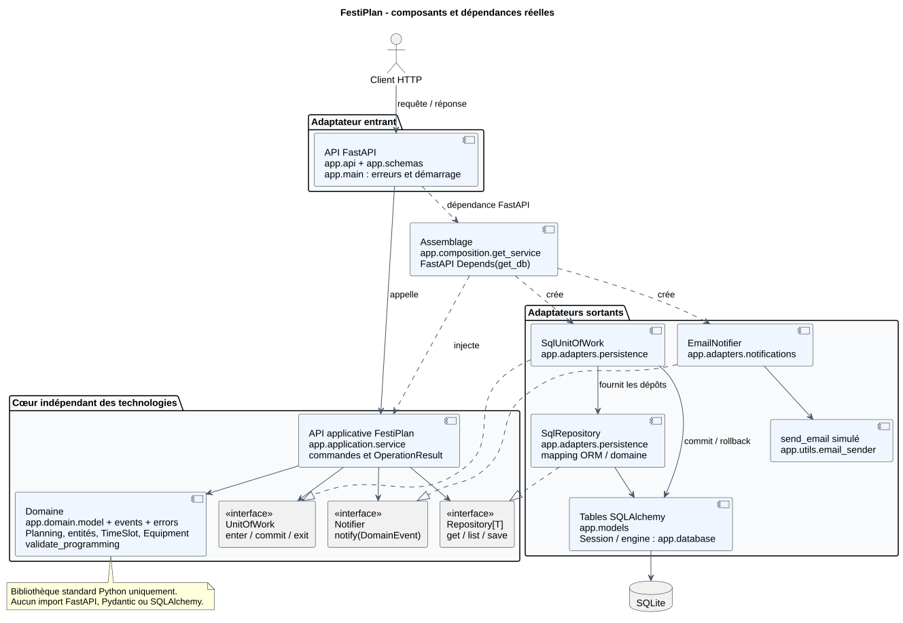
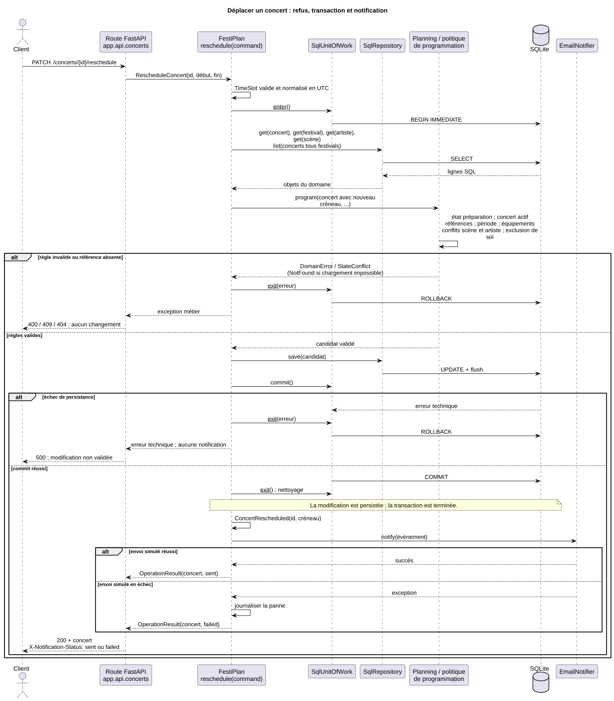

# Note d'architecture FestiPlan

## Objectif et démarche

Le monolithe est conservé. Le problème initial concernait les responsabilités et les invariants, pas le nombre de services déployés. Le [diagnostic initial](diagnostic_initial.md) décrit les dépendances observées et les trois défauts reproduits. Les tests de non-régression ont échoué sur les anciennes routes avant de réussir sur les nouvelles.

Le déplacement a servi de premier parcours : création d'un créneau valide, vérification commune des règles, persistance atomique, puis notification. Les autres parcours ont ensuite été raccordés aux mêmes concepts. Les anciens services et repositories ont été retirés pour éviter de conserver un deuxième chemin qui contournerait les règles.

## Architecture réelle

Le [source PlantUML](composants.puml) est fourni et modifiable.

| Élément | Responsabilité |
| --- | --- |
| `app/domain/` | Entités immuables, objets-valeurs, agrégat Planning, politique de programmation, erreurs et événements |
| `app/application/service.py` | API applicative `FestiPlan` : orchestre chaque cas d'utilisation et sa transaction |
| `app/application/commands.py` | Commandes de programmation et de déplacement indépendantes de Pydantic |
| `app/application/ports.py` | Contrats sortants `Repository[T]`, `UnitOfWork` et `Notifier` définis avec `Protocol` |
| `app/api/`, `app/schemas.py` | Adaptateur entrant FastAPI et validation des formats Pydantic |
| `app/adapters/persistence.py` | `SqlRepository`, mapping entre objets métier et lignes ORM, `SqlUnitOfWork` |
| `app/models.py`, `app/database.py` | Détails de stockage conservant les tables et colonnes du projet initial |
| `app/adapters/notifications.py` | Réaction technique aux événements via un expéditeur simulé |
| `app/composition.py` | Création et injection des adaptateurs dans `FestiPlan` avec les dépendances FastAPI |
| `app/main.py` | Démarrage, enregistrement des routes et traduction globale des erreurs métier en HTTP |

`create_app(database_engine=...)` permet de construire une application avec un moteur distinct. Les tests remplacent également `get_db` par leur propre fabrique de sessions ; ils ne modifient plus l'environnement global pour rediriger la persistance.

Le cœur n'importe ni FastAPI, ni Pydantic, ni SQLAlchemy, ni la configuration globale. Les adaptateurs dépendent des contrats du cœur. Les routes appellent des méthodes applicatives et ne font aucune requête SQL. L'API publique de `FestiPlan` constitue le point d'entrée applicatif ; les contrôleurs sont ses adaptateurs entrants. Une interface distincte pour chaque méthode n'apporterait pas de bénéfice ici.

Le repository générique expose seulement `get`, `list` et `save`. Ses cinq instances restent typées dans le port d'unité de travail. Il ne fait jamais de commit. L'unité de travail regroupe toutes les lectures et écritures d'un cas d'utilisation et garantit un rollback en sortie en l'absence de validation. Les cas d'utilisation reçoivent ces ports dans leur constructeur ; ils n'instancient aucun adaptateur SQL ou email.

## Modèle DDD et frontières de cohérence

Les entités **Festival**, **Concert**, **Artist**, **Stage** et **Incident** possèdent une identité durable. Les objets sont immuables : une modification produit un nouvel objet validé. Un identifiant `0` désigne uniquement une entité pas encore persistée ; les références à d'autres entités sont positives.

**TimeSlot** est un objet-valeur représentant aussi bien un créneau qu'une période de festival. Il impose une fin strictement postérieure au début, propose `contains` et `overlaps`, et normalise les dates avec fuseau en UTC sans suffixe pour rester compatible avec les colonnes SQLite initiales. Deux intervalles contigus ne se chevauchent pas : leur borne de fin est exclusive pour le contrôle des conflits, et le début et la fin d'un concert peuvent coïncider avec les bornes du festival.

**Equipment** est un ensemble immuable normalisé de noms d'équipements. Les espaces sont retirés, les doublons supprimés et les noms vides ou contenant une virgule refusés. Le séparateur virgule est réservé au stockage existant. Une scène satisfait les besoins d'un artiste si elle contient tous les équipements requis.

**Planning** est l'agrégat de cohérence constitué du festival, qui porte l'état, et de ses concerts. Il protège la programmation, le déplacement, l'annulation et la publication. Il vérifie toujours ses propres enfants, même si la liste externe des concerts est incomplète ; il refuse les identifiants dupliqués, les concerts d'un autre festival et la modification d'un concert absent de l'agrégat. La collection est copiée en tuple pour empêcher une mutation indirecte. Il n'existe pas de table Planning supplémentaire : le repository de festivals conserve la racine et celui des concerts conserve les enfants, dans la même unité de travail. Les artistes, les scènes et les incidents sont des entités à cycle de vie distinct ; ils ne sont pas copiés dans chaque concert. La scène référence son festival. L'incident référence un concert et ne modifie pas le planning.

La politique pure `validate_programming` contrôle les relations, la période, les équipements et les disponibilités. Les disponibilités d'un artiste dépassent un festival : la politique reçoit les concerts de tous les festivals. Cette contrainte entre agrégats ne serait pas garantie par un Planning isolé ; le cas d'utilisation charge les données nécessaires dans la même transaction. Pour SQLite, `BEGIN IMMEDIATE` sérialise le parcours lecture-vérification-écriture. Le test concurrent confirme qu'une seule de deux réservations incompatibles est acceptée.

Les objets construits depuis la base sont également validés. Une donnée historique invalide est refusée plutôt que publiée silencieusement. La publication relance la politique sur chaque concert actif, y compris les données introduites directement en SQL.

## Invariants et traçabilité des exigences

| Règle | Protection principale | Vérification représentative |
| --- | --- | --- |
| R1 : durée positive | `TimeSlot.__post_init__` | `tests/domain/test_model.py::test_r1_strictly_positive_duration` |
| R2 : disponibilité de la scène | `validate_programming` | `tests/integration/test_regressions.py::test_regression_move_onto_occupied_stage_is_refused` |
| R3 : disponibilité globale de l'artiste | Même politique, tous festivals | `test_global_artist_conflict_applies_across_festivals` et `test_artist_conflict_different_stages_rejected_on_create_and_move` |
| R4 : références existantes et cohérentes | Chargement applicatif `required`, puis politique | `test_creation_checks_all_references`, `test_wrong_festival_stage_is_rejected` |
| R5 : équipements | `Equipment.supports`, politique | `test_r5_equipment_is_checked_in_domain`, `test_missing_equipment_rejected` |
| R6 : inclusion dans la période | `TimeSlot.contains`, politique | `test_r6_entire_concert_inside_festival`, `test_move_outside_festival_rejected_without_change` |
| R7 : état publié protégé | `Festival.require_editable`, `Planning` | `test_published_planning_blocks_all_ordinary_writes_then_can_be_reopened` |
| R8 : publication cohérente | `Planning.publish` revalide chaque concert | `test_publication_refuses_inconsistent_imported_data`, `test_publication_rechecks_sql_data_and_preserves_preparation_on_error` |
| R9 : capacité et valeurs obligatoires positives | `Stage`, `TimeSlot`, identifiants ; Pydantic en complément | `test_r9_capacity_validated_without_http`, tests initiaux HTTP |
| R10 : incident valide | Objet `Incident` et existence contrôlée dans le cas d'utilisation | `test_r10_incident_description_not_blank`, `test_incident_requires_existing_concert_without_http` |

Il n'existe pas d'autre quantité ni de durée chiffrée indépendante dans ce modèle. R9 couvre donc la capacité, les références obligatoires et la durée résultant du créneau.

## États et comportement retenu

Le cycle du planning est `preparation -> published -> preparation`. Publier un planning déjà publié ou dépublier un planning en préparation produit un conflit d'état. La dépublication est explicite via `POST /festivals/{id}/unpublish` ; elle ne se produit jamais automatiquement.

Un planning publié refuse la création, le déplacement et l'annulation de concerts, ainsi que l'ajout d'une scène. La déclaration d'incidents reste disponible, puisqu'elle décrit un fait survenu et ne modifie pas la programmation. Les concerts annulés libèrent leur créneau et sont exclus du planning public ; ils restent consultables individuellement. Leur déplacement est refusé, et aucune réactivation implicite n'est proposée. Un planning vide peut être publié : le sujet n'impose pas de nombre minimal de concerts.

## Commande, événement et effet secondaire

`RescheduleConcert` représente une demande. `FestiPlan.reschedule` est le cas d'utilisation qui charge les données, fait appliquer les invariants et valide l'écriture. `ConcertRescheduled` représente ensuite le fait accompli. `EmailNotifier` est le mécanisme technique qui transforme cet événement en appel à `send_email`. `PlanningPublished` et `PlanningUnpublished` suivent le même principe.

Le [source PlantUML](sequence_deplacement.puml) couvre les refus, l'échec de persistance et l'échec de notification.

La notification est synchrone mais exécutée **après le commit réussi et la fermeture de la transaction**. Une panne de l'expéditeur est journalisée avec sa trace, puis le résultat métier est retourné avec `notification_status='failed'`. L'adaptateur HTTP conserve le corps de réponse existant et ajoute `X-Notification-Status: sent` ou `failed`. Un déplacement ou une publication enregistrés retournent 200 même si l'envoi a échoué. Il ne faut pas relancer la commande métier pour tenter de renvoyer une notification.

À l'inverse, un échec du commit annule la transaction et ne déclenche aucun événement vers l'expéditeur. Le domaine et l'application n'emploient aucun code HTTP : `DomainError` est traduit en 400, `NotFound` en 404, `StateConflict` en 409. Pydantic continue de produire 422 pour un format HTTP invalide.

## Stratégie et résultats de tests

- `tests/domain/` : invariants, créneaux, adjacence, équipements, transitions et politique de programmation. Aucun démarrage FastAPI ni accès SQLite.
- `tests/application/` : cas d'utilisation avec dépôts et unité de travail en mémoire. Vérification du rollback, des appels aux ports et de l'ordre commit/notification.
- `tests/integration/` : routes FastAPI et vrais adaptateurs SQLAlchemy sur une base temporaire ; relecture des données après succès et refus, publication de données corrompues, panne de commit, concurrence et initialisation des données.
- `tests/test_isolation.py` : exécution des non-régressions dans un processus ayant déjà importé la configuration de travail ; vérification que sa base reste strictement inchangée.
- `tests/test_architecture.py` : direction des dépendances et import du cœur dans un processus indépendant sans charger les frameworks.

Les trois tests de non-régression initiaux échouaient avant correction. La sortie initiale et les résultats HTTP relus sont archivés dans ce dossier. Le [rapport final](tests_apres.txt) donne le résultat de la suite complète. Les tests initiaux sont conservés sous `tests/integration/`.

## Compromis et limites

La notification n'utilise ni file de messages ni outbox persistante. Une interruption du processus après commit et avant envoi peut donc perdre la notification, et aucun retry automatique n'est fourni. La journalisation et le résultat explicite répondent au problème du sujet ; une livraison garantie demanderait une outbox enregistrée dans la même transaction, puis un worker avec déduplication.

Les listes sont chargées intégralement et le contrôle des conflits est linéaire. Ce choix rend la politique facile à tester et convient au jeu de données pédagogique. Des recherches ciblées par intervalle et des index seraient nécessaires à plus grande échelle. L'unité de travail réserve un verrou SQLite même pour ses opérations de lecture, ce qui simplifie la cohérence mais limite le parallélisme.

La sérialisation concurrente est garantie et testée pour SQLite. Changer le moteur SQL demande de définir un verrouillage ou un niveau d'isolation équivalent ; la compatibilité SQLAlchemy seule ne suffit pas. Une écriture SQL extérieure peut toujours contourner les invariants : la revalidation à la lecture et à la publication constitue une protection supplémentaire, sans remplacer des contraintes de base et une politique d'accès.

Le schéma initial est conservé. Aucun dispositif de migration Alembic complet, authentification, historique des dépublications ou bus d'événements distribué n'est ajouté. Les dates naïves historiques sont interprétées comme UTC ; l'interface conserve leur forme sans suffixe. Une future migration vers des dates explicitement zonées devra tenir compte des anciennes données. L'initialisation de démonstration est atomique et refuse d'effacer une base remplie sans l'option `--reset`.
